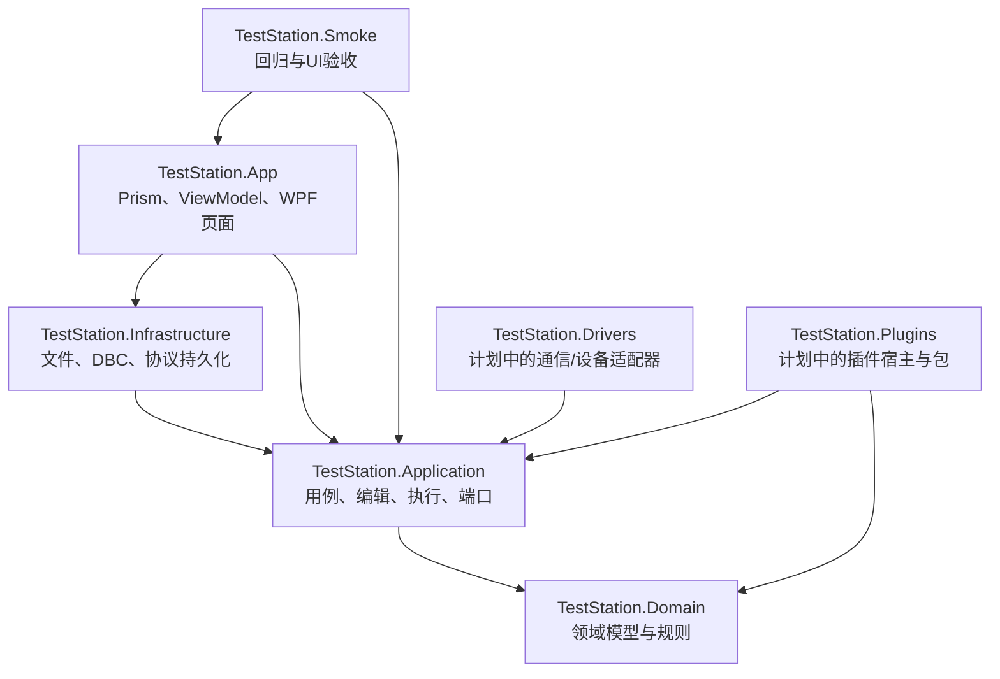

# Test Station 总体架构

本文档定义 `TestStation.Replica.Wpf` 的模块边界和依赖方向。它对应当前 .NET 10、Prism、MVVM、分层模块化实现，后续设备驱动、插件和真实通信接入都必须遵守这里的边界。

## 模块依赖



箭头表示“编译依赖”。`TestStation.App` 是组合根，可以引用基础设施和 UI 第三方包；其他业务层不能反向引用 App，也不能引用 WPF、HandyControl、Industrial.Controls、MaterialDesign 或 AvalonDock。

| 模块 | 当前职责 | 允许依赖 | 禁止依赖 |
|---|---|---|---|
| `TestStation.Domain` | `SequenceDefinition`、步骤、变量、手动画布、协议/DBC 模型和值对象 | BCL | WPF、Prism、UI 库、文件系统、厂商 DLL |
| `TestStation.Application` | 序列编辑、文档事务、执行引擎、协议编辑/预览、画布编辑、应用端口 | Domain、BCL | WPF、ViewModel、控件、具体串口/CAN SDK |
| `TestStation.Infrastructure` | 工程文件、序列/画布/协议仓储、DBC 解析和编码实现 | Application、Domain、BCL | View、ViewModel、Prism、控件库 |
| `TestStation.App` | Prism 模块、View、ViewModel、主题、停靠、鼠标/键盘和拖拽适配 | Application、Infrastructure、UI 包 | 在 View 中直接写领域规则或直接访问驱动 |
| `TestStation.Smoke` | 逻辑回归、UI Automation、模拟运行验收 | App、Application | 生产代码职责 |
| `TestStation.Drivers`（计划） | CAN、串口、TCP、Modbus 和厂商 DLL 的适配器 | Application、厂商 SDK | 页面、ViewModel、主题 |
| `TestStation.Plugins`（计划） | 插件清单、加载、版本检查、导入导出 | Application、Domain | 直接修改宿主页面和主题资源 |

## 页面与业务调用方向

```text
View / Code-behind
    ↓ 事件、命令、绑定
ViewModel
    ↓ Prism 服务和应用接口
Application Service / Editor / Execution Engine
    ↓ Domain model + Port
Infrastructure implementation
    ↓ 文件、DBC、通信适配器或插件
外部资源
```

页面只负责布局和事件组合。ViewModel 负责页面状态、命令和验证结果。结构修改必须经过应用服务，执行引擎只接收领域模型副本。任何新页面先注册到 Prism 模块，再接入导航；不得在 `MainWindow.xaml.cs` 中堆叠业务逻辑。

手动画布遵循同一边界：`ManualTestView` 负责布局和事件转发，`ManualCanvasInteractionController` 负责 WPF 命中测试、选择、拖拽、缩放和键盘手势，`ManualInstrumentFactory` 负责创建已发布的 Industrial.Controls 控件，`ManualWidgetConfigurationAdapter` 负责配置快照与控件属性互转，`ManualTestViewModel` 维护选择、状态和命令，`IManualCanvasDocumentService` 负责对 `ManualCanvasDefinition` 的新增、更新和删除，`IManualCanvasEditingService` 负责网格预览与格式校验，`IManualCanvasRepository` 负责持久化。ViewModel 不直接改变画布文档的控件集合。

## 模块拆分计划

当前已经存在 `ShellModule`、`ProtocolModule` 和 `ManualTestModule`。下一阶段按以下边界扩展：

| 模块 | 内容 | 注册位置 |
|---|---|---|
| Shell | 工程入口、主题、全局导航、近期工程 | `ShellModule` |
| Protocol | 协议库、自定义帧、DBC、离线测试 | `ProtocolModule` |
| ManualTest | 画布、控件工具箱、属性和通道绑定 | `ManualTestModule` |
| AutoTest | 步骤库、序列编辑、变量、日志、执行工具栏 | 新增 `AutoTestModule`，从 Shell 页面组合中逐步拆出 |
| Resources | 设备、通信资源、通道、映射和轮询策略 | `ResourceModule`，资源结构编辑通过 `IResourceCatalogEditingService` |
| Drivers | 真实传输和设备适配器 | 新增 `DriverModule`，仅由组合根加载 |
| Plugins | 插件目录、清单、版本和启停 | 新增 `PluginModule` |

`AutoTestModule`、`ResourceModule`、`DriverModule`、`PluginModule` 在相应模型和服务准备好以前不创建空壳页面，避免提前复制依赖关系。

## 分层规则检查结果

本轮检查现有项目引用关系：

- Domain、Application、Infrastructure 的项目文件没有 UI 包引用。
- Infrastructure 只实现 Application 定义的仓储/协议端口。
- App 是当前唯一的 UI/基础设施组合根。
- Smoke 只引用 App/Application，不进入生产模块依赖。
- 当前真实硬件驱动尚未加入工程，执行引擎仍使用 `IChannelGateway` 的模拟实现。
- 资源目录已形成独立的编辑边界：`ResourceCatalogEditingService` 负责新增、删除、引用检查和属性更新；页面不再直接操作资源集合。
- 当前仍使用模拟传输和模拟设备，真实串口、TCP、CAN、Modbus 适配器不在本阶段接入。

后续每增加一个项目或 PackageReference，必须同时更新本文件和 `docs/INTERFACE_CATALOG.md`。
