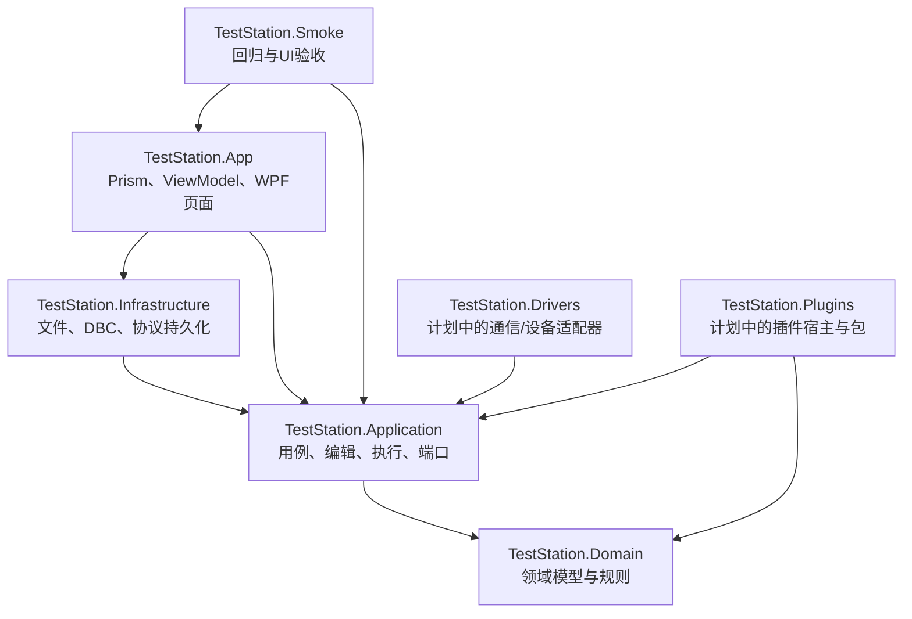

# Test Station 总体架构

本文档定义 `TestStation.Replica.Wpf` 的模块边界和依赖方向。它对应当前 .NET 10、Prism、MVVM、分层模块化实现，后续设备驱动、插件和真实通信接入都必须遵守这里的边界。

## 模块依赖



箭头表示“编译依赖”。`TestStation.App` 是组合根，可以引用基础设施和 UI 第三方包；其他业务层不能反向引用 App，也不能引用 WPF、HandyControl、Industrial.Controls、MaterialDesign 或 AvalonDock。

| 模块 | 当前职责 | 允许依赖 | 禁止依赖 |
|---|---|---|---|
| `TestStation.Domain` | `SequenceDefinition`、步骤、变量、手动画布、协议/DBC 模型和值对象 | BCL | WPF、Prism、UI 库、文件系统、厂商 DLL |
| `TestStation.Application` | 序列编辑、文档事务、执行引擎、协议编辑/预览、画布编辑、应用端口 | Domain、BCL | WPF、ViewModel、控件、具体串口/CAN SDK |
| `TestStation.Infrastructure` | 工程文件、序列/画布/协议仓储、DBC 解析和编码实现 | Application、Domain、BCL | View、ViewModel、Prism、控件库 |
| `TestStation.App` | Prism 模块、View、ViewModel、主题、停靠、鼠标/键盘和拖拽适配 | Application、Infrastructure、UI 包 | 在 View 中直接写领域规则或直接访问驱动 |
| `TestStation.Smoke` | 逻辑回归、UI Automation、模拟运行验收 | App、Application | 生产代码职责 |
| `TestStation.Drivers`（计划） | CAN、串口、TCP、Modbus 和厂商 DLL 的适配器 | Application、厂商 SDK | 页面、ViewModel、主题 |
| `TestStation.Plugins`（计划） | 插件清单、加载、版本检查、导入导出 | Application、Domain | 直接修改宿主页面和主题资源 |

## 页面与业务调用方向

```text
View / Code-behind
    ↓ 事件、命令、绑定
ViewModel
    ↓ Prism 服务和应用接口
Application Service / Editor / Execution Engine
    ↓ Domain model + Port
Infrastructure implementation
    ↓ 文件、DBC、通信适配器或插件
外部资源
```

页面只负责布局和事件组合。ViewModel 负责页面状态、命令和验证结果。结构修改必须经过应用服务，执行引擎只接收领域模型副本。任何新页面先注册到 Prism 模块，再接入导航；不得在 `MainWindow.xaml.cs` 中堆叠业务逻辑。

当前手动测试页只保留工区标签、平铺/层叠外壳和插件界面宿主。`IManualPluginViewProvider` 描述插件界面，`IManualPluginViewRegistry` 管理注册变化，`ManualTestView` 在同一个工区内提供标签查看或平铺查看。旧画布服务仍保留用于历史工程格式兼容，但不应再成为新插件页面的依赖。

## 模块拆分计划

当前启动链使用 `ShellModule`、`ManualTestModule` 和 `ResourceModule`。协议页面实现仍按独立模块边界保留，待功能重新接入时恢复 `ProtocolModule`；下一阶段按以下边界扩展：

| 模块 | 内容 | 注册位置 |
|---|---|---|
| Shell | 工程入口、主题、全局导航、近期工程 | `ShellModule` |
| Protocol | 协议库、自定义帧、DBC、离线测试（当前暂不注册） | 恢复接入时使用 `ProtocolModule` |
| ManualTest | 画布、控件工具箱、属性和通道绑定 | `ManualTestModule` |
| AutoTest | 步骤库、序列编辑、变量、日志、执行工具栏 | 新增 `AutoTestModule`，从 Shell 页面组合中逐步拆出 |
| Resources | 设备、通信资源、通道、映射和轮询策略 | `ResourceModule`，资源结构编辑通过 `IResourceCatalogEditingService` |
| Drivers | 真实传输和设备适配器 | 新增 `DriverModule`，仅由组合根加载 |
| Plugins | 插件目录、清单、版本和启停 | 新增 `PluginModule` |

`AutoTestModule`、`ResourceModule`、`DriverModule`、`PluginModule` 在相应模型和服务准备好以前不创建空壳页面，避免提前复制依赖关系。

## 分层规则检查结果

本轮检查现有项目引用关系：

- Domain、Application、Infrastructure 的项目文件没有 UI 包引用。
- Infrastructure 只实现 Application 定义的仓储/协议端口。
- App 是当前唯一的 UI/基础设施组合根。
- Smoke 只引用 App/Application，不进入生产模块依赖。
- 首期 ITECH IT6000 家族已经接入 TCP 和串口传输、SCPI 会话、独占资源租约和设备会话；通用层还提供 VISA 后端边界、CAN/CAN FD 模拟总线，以及 PCAN-Basic 适配器。PCAN 四通道设备已完成通道 1→2 的真实收发和 OpenTAP 自动调用验收；其他 ZLG/NI/Kvaser 等厂商驱动仍未接入。
- 资源目录已形成独立的编辑边界：`ResourceCatalogEditingService` 负责新增、删除、引用检查和属性更新；页面不再直接操作资源集合。
- 当前仍保留模拟插件用于历史示例，但 ITECH 页面和 OpenTAP 通道通过 `PowerSupplyDeviceService` 统一访问 TCP/串口会话；真实 RS485（COM3↔COM6）和 PCAN（通道 1→2）已完成短验收，CAN、Modbus 和外部插件包不在本阶段接入。

后续每增加一个项目或 PackageReference，必须同时更新本文件和 `docs/INTERFACE_CATALOG.md`。

## 当前架构整理状态（2026-10）

本轮将自动测试和手动测试作为当前产品入口，主窗口不再启动协议、CAN 页面；协议和 CAN 实现仍保留在仓库中，作为后续模块恢复时的独立实现。设备资源模块仍由当前启动链提供设备和通信资源管理。通用对话框通过 Shell 提供的 `IAppDialogService` 注册，自动测试不再通过协议模块解析对话框。工程文件、序列工作区、站变量、模拟通道和模拟场景的读写已经集中到 `IAutomaticWorkspaceService`，运行报告读取集中到 `ISequenceReportService`，ViewModel 不再直接创建这些仓储。

步骤属性中的普通步骤和判定步骤已经分开保存：普通步骤使用 `on_complete`，判定步骤使用 `on_failure`。`ISequenceStepCatalog` / `BuiltInSequenceStepCatalog` 为步骤元数据和后续插件注册提供应用层边界；预检使用该目录识别内置步骤。

自动测试 ViewModel 通过 `ISequenceExecutionHost` 依赖执行宿主，当前实现为独立进程 `OpenTapHostClient`。OpenTAP Host 仍维护自己的 JSON 编译清单，这是进程隔离下的临时边界；接入外部步骤插件前，需要把步骤描述、版本和执行能力抽成共享契约，并让 Host 根据插件目录加载。

跨进程命令和事件的版本号现在由 `TestStation.Contracts` 中的 `ExecutionProtocol` 统一维护，Host 会拒绝不兼容的协议版本。步骤定义和插件执行适配仍需要继续接入同一契约。

仍需后续处理的架构债务：`MainViewModel` 仍包含工程、编辑、变量和执行状态；旧的 `SequenceExecutionEngine` 仍保留供 Smoke 使用；手动测试旧画布模型和仓储仍在工程中。它们本轮没有删除，以免破坏已有工程格式和历史回归入口，正式硬件插件接入前应继续隔离或迁移。

本轮电源家族已接入组合根：`PowerSupplyDeviceService` 是 TCP/串口电源实例的唯一运行时入口，页面不再直接创建 TCP 会话。家族 Profile、型号覆盖、通道映射和资源绑定分别位于 Domain/Application/Infrastructure 边界；OpenTAP 仍通过 `channel_request` 调用该服务。VISA/CAN 适配器仍是明确的未接入边界。
- HIOKI PW6001 已按同一边界接入：`HiokiPowerAnalyzerDeviceService` 负责实例、TCP 资源、SCPI 会话和六通道测量驱动，`CompositeDeviceIoBackend` 将 ITECH 与 HIOKI 路由到同一个手动/自动协调器。页面只通过 `IManualPluginViewProvider` 注册，不创建传输会话。PW6001 目前只支持 TCP，真实硬件尚未验证。
